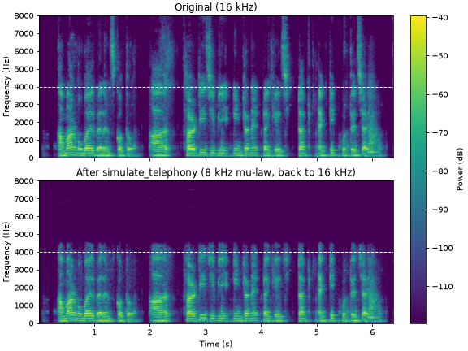

# Kotha

A Bangla-English voice AI agent and call-analytics platform for Nodi Telecom, a fictional telecom operator.

[](https://github.com/KsKarim7/Kotha/actions/workflows/ci.yml)

## Status

Milestone 1 (a browser call works) is built, apart from the items under "Limits and next" that need people (a repeat microphone call in a browser, recordings, listeners). A call takes speech in Bangla, English or a mix of both, and Kotha answers questions about Nodi Telecom's packs and policies by voice, citing the documents it used. Calls were tested with synthetic speech streamed over the WebSocket. The speech and retrieval models run on one machine, on the CPU by default (the Docker stack is CPU-only; ASR can run on the local GPU, see EVALUATION.md); the LLM is Gemini, a remote API. The phone path, account actions, barge-in and post-call analytics come in later milestones.

## What works now

- **Browser call.** A static page streams the microphone (with echo cancellation) to `/v1/calls/stream` as 16 kHz PCM16, plays the bot's audio back and shows the caller's transcript and each answer with the titles of its sources. The caller must tick a consent box first.
- **Turn taking.** Silero VAD with a turn detector (hangover, pre-roll, a 30 s cap) decides when the caller has finished. Only confirmed speech reaches speech recognition.
- **Speech recognition.** faster-whisper with a Bangla fine-tune, on the CPU. Empty transcripts and transcripts that look like a decoding loop are refused; two failed turns in a row hand off to a human.
- **Answers.** Hybrid retrieval (pgvector with bge-m3, plus BM25 with a loanword lexicon, fused by RRF) over 16 bilingual knowledge-base documents. Gemini writes a short answer in the caller's language. Code checks that every sentence cites a retrieved passage, that every number is in a cited passage, that no money amount appears, and that the bot never claims to have changed the caller's account. Account requests get a fixed "not available yet" reply before the LLM runs.
- **Speech.** MMS-TTS voices for Bangla and English, fed only text they can say: numbers, codes and English terms are turned into words in code.
- **Operations.** Models load and warm before the app accepts calls (`/v1/ready`), logs carry only allow-listed fields (never what anyone said), and `eval/` holds the scripts behind every reported number.

```
browser --PCM16--> VAD + turn detector --> Whisper --> account routing --> hybrid retrieval
                                                                         --> Gemini + checks
browser <--PCM16-- MMS-TTS <-- speakable text <------------------------------------+
```

[docs/ARCHITECTURE.md](docs/ARCHITECTURE.md) describes each part and the WebSocket protocol.

## Phone audio vs 16 kHz

The two spectrograms show the same code-mixed Bangla-English utterance in the author's voice: on top resampled to 16 kHz, below after `simulate_telephony`, a mu-law telephony simulation (not bit-exact G.711) that passes the audio through 8 kHz and back.
Energy above the dashed 4 kHz line is strongly attenuated on the phone path, which is part of why speech recognition is harder on phone audio.



Regenerate the figure from a recording with:

```bash
uv run python eval/plot_spectrograms.py <recording> --output docs/img/spectrogram_telephony.png
```

## Fictional data

Nodi Telecom and all telecom data in this repository are fictional. No real operator's name, tariffs or logo are used.

## Development quickstart

Prerequisite: [uv](https://docs.astral.sh/uv/). uv installs Python 3.11 for you.

```bash
uv sync
uv run pre-commit install
uv run pytest -q
uv run ruff check . && uv run ruff format --check .
```

The database tests are skipped unless `DATABASE_URL` is set; `docs/runbook.md` ("Local database")
shows how to start PostgreSQL with Docker and run them.

## Run the stack

Prerequisites: Docker, uv, a Gemini API key, and the models in place before the first start:
bge-m3 and the MMS voices in the Hugging Face cache and a converted Whisper model in `models/`.
The one-time download and conversion commands are in `docs/runbook.md` and run with `uv run`, so
run `uv sync` first. Create `models/` yourself before starting compose; otherwise Docker creates
it owned by root and the conversion cannot write into it.

```bash
cp .env.example .env                                     # then fill in the key and a password
docker compose up -d --wait db
docker compose run --rm app python -m kotha.kb.ingest    # once, and after editing data/kb/
docker compose up -d --wait app                          # CPU image; ready when healthy
```

Open http://127.0.0.1:8000, tick the consent box and press Start. `docs/runbook.md` ("Docker
stack") explains the settings.

## Results

Every number comes from a committed evaluation run and is reported, with its run and caveats, in [EVALUATION.md](EVALUATION.md). Values not yet measured stay `[measure]` there.

| Measure | Result | Run |
| --- | --- | --- |
| Retrieval, typed questions, hybrid (RRF): hit@3 / MRR | 0.903 / 0.840 (72 questions) | `eval/retrieval.py`, MLflow `39b2a864` |
| Retrieval, typed questions, dense only: hit@3 / MRR | 0.958 / 0.893 | same run |
| TTFA from the end of speech, answered turns, ASR on the CPU: p50 / p95 | 16.981 s / 27.149 s (45 turns, synthetic speech) | `eval/latency.py`, MLflow `fba66a2f` |
| The same, ASR (tugstugi) on the GPU: p50 / p95 | 11.928 s / 20.113 s (44 turns) | `eval/latency.py`, MLflow `64d884be` |
| TTFA over all heard turns, handoffs included, GPU: p50 / p95 | 10.239 s / 19.132 s (69 turns) | same run |
| TTS real-time factor, CPU, p50 (bn / en) | 0.230 / 0.224 | `eval/tts_probe.py`, MLflow `ebbb1c69` |
| Cold start, process start to ready, CPU | 68.080 s | `eval/cold_start.py`, MLflow `ca512651` |

ASR word error rates, the VAD ablation and the TTS listening scores need the recorded test set and listeners, and are `[measure]`.

## Limits and next

- **Latency.** The per-stage p50 and p95 for the CPU and the GPU are in [EVALUATION.md](EVALUATION.md#latency), with the cold-start breakdown; the interpretation is still to be written. The blueprint plans streamed LLM tokens for MS2.
- **Handoffs.** In the two tugstugi runs on `46d3bed`, 26 of 72 synthetic turns ended in a handoff, most of them `no_answer`, and English questions most often (EVALUATION.md lists the reasons). Each handoff now says why, in the log and on the page.
- **Gemini free tier.** On 2026-11-23 and 24 (local time) `gemini-3.1-flash-lite` answered 503 to many requests in diagnostic probes, and the key's daily quota ran out after a day of evaluation runs. A handoff then says `llm_unavailable` or `llm_rate_limited`; the runbook ("Running the app") says what to do.
- **Speech recognition.** The default live model is a Bangla fine-tune (`bn-tugstugi-medium-ct2`). How it handles English speech is not measured yet; choosing the live model from measured WER is still open (M3-6). ADR 0005 records the GPU latency of both fine-tunes as input.
- **Guardrails.** Account requests and account claims are caught by patterns in code; ADR 0008 lists phrasings they still miss and proposes a structural rule for MS2.
- **Not yet built.** Account tools and the mock BSS, barge-in, the phone path through Asterisk, and post-call analytics.
- **Checked by people only once.** The first real microphone call in Chrome (2026-11-23) heard the greeting and transcribed the question correctly, then handed off because Gemini was overloaded; a repeat call after the fixes is still to come. Nobody has rated the TTS listening sheet yet.

## Documentation

- [Project specification](docs/blueprint/05_blueprint_spec.md)
- [Architecture](docs/ARCHITECTURE.md)
- [Runbook](docs/runbook.md)
- [Evaluation report](EVALUATION.md)
- [Study log](docs/STUDY.md)
- [Changelog](CHANGELOG.md)
- [Decision records](docs/adr/)

## Licence

The code is released under the MIT licence; see [LICENSE](LICENSE).

Third-party models keep their own licences, and Kotha does not ship model weights. The text-to-speech models, `facebook/mms-tts-ben` for Bangla and `facebook/mms-tts-eng` for English, are licensed CC-BY-NC 4.0, which allows non-commercial use only.
